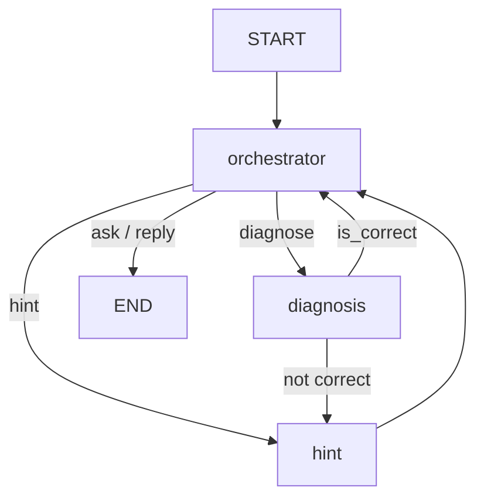
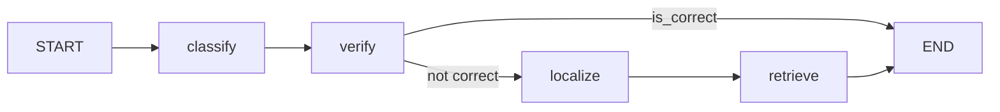

# Architecture

Source: the planning handoff of 2026-10-25. Items marked OPEN are not decided.

## Problem and scope
Students repeat the same algebra mistakes. Modern chatbots can tutor well given enough context, and a
prompt can ask for a Socratic structure, but that structure gradually gets lost, and a student who
loses discipline can ask for a faster answer. This system acts as a teacher who cannot be sped up:
verification, the hint ladder and the leakage check are enforced by the graph and tools, not left to
a prompt. The student submits a problem and their own step-by-step attempt
(math lines plus natural-language justifications). The tutor:
1. verifies the steps symbolically;
2. finds the first wrong step, or the type of error if no single step is wrong;
3. retrieves the most likely misconception from a catalogue;
4. gives graded Socratic hints without revealing the answer;
5. tracks attempts and weak topics across sessions and suggests targeted practice.

In scope: school-level arithmetic and algebra (linear equations, brackets, quadratics, factoring,
radical and rational equations). Out of scope: calculus, proofs, geometry diagrams, other languages.
Target level (provisional): MATH "Algebra", levels 1-3. OPEN: confirm the grades.

This is not vanilla RAG: retrieval answers "which misconception explains this wrong step?" over a
misconception catalogue, inside a verified diagnosis pipeline with an agentic conversation layer.

## Design
Hybrid: a deterministic pipeline at the core, wrapped in a small agentic layer. The agent decides
when and whether to do things; the pipeline decides how diagnosis is done. Each stage can be
evaluated in isolation on its own dataset.

### Main graph

The orchestrator sets the reply text for `ask` and `reply`. Hints come back to the orchestrator,
which checks them for answer leakage before replying.

### Diagnosis subgraph
Fixed order, compiled separately so evals can call it without the chat layer.

### Around the graph
- Learner DB (SQLite), exposed to the orchestrator as tools `get_profile` and `record_attempt`.
- Checkpointer: state saved after each run, keyed by `thread_id`. One `invoke` is one student
  message. This is how `hint_level` and seen misconceptions persist across turns.
- UI: Streamlit chat (`app.py`).
- `scripts/draw_graph.py` exports the compiled graph to Mermaid.

## Nodes
| Node | Type | Purpose | Reads | Writes | Metric |
|---|---|---|---|---|---|
| orchestrator | LLM, structured output (`Decision`) | Decide the next action; ask for working when missing; escalate or reset hint level; check hint leakage; call DB tools | messages, state so far | next_action, hint_level, learner_profile, reply | routing accuracy on labelled turns |
| classify | LLM | Tag topic and level; split each step into claim and justification; tag the operation | problem, raw message | topic, level, student_steps | topic accuracy / macro-F1; step-split accuracy; SymPy parse rate of claims |
| verify | deterministic (SymPy) | Solve the original; check the final answer; check each step as equivalent / implies / not_valid; evaluate arithmetic claims in justifications | problem, student_steps | is_correct, step_verdicts | answer-check accuracy; step-verdict accuracy |
| localize | rules on SymPy verdicts, LLM only for interpretation | First wrong step or error type; check that the justification matches what happened | step_verdicts, student_steps | first_error_step, error_type | first-error-step accuracy; error-type accuracy; mismatch detection rate |
| retrieve | retrieval | Query: problem + wrong step + topic + error type; search the misconception catalogue | above | misconception_candidates, misconception | Recall@k, MAP@k |
| hint | LLM | Socratic hint grounded in the misconception, at `hint_level`; praise what was right; never give the answer | misconception, wrong step, hint_level, profile | hint text (via messages) | answer-leakage rate (automatic); rubric judge and a small human check |

Hard rule: the LLM never does arithmetic or verifies algebra. SymPy does. `localize` uses rules
first (the first `not_valid` verdict gives the step and error type); the LLM only interprets and
checks justifications.

Hint leakage check: a deterministic function in `src/tutor/tools/`, called by the orchestrator. It
rejects a hint containing the final answer or the key correct intermediate expression (for example
`3x + 6`, `x^2 - 10x + 25`), compared with SymPy where possible, not only by string match.
OPEN: what happens on rejection (regenerate with a cap, canned fallback, or loop back to `hint`).

## Required behaviours
1. Answer only, no steps: `ask` for working; diagnosis is not run.
2. The student asks a question instead of a new attempt: diagnosis is skipped; the hint level
   escalates for the same misconception.
3. Hint levels: 1 Socratic question; 2 concrete numeric counterexample; higher levels more direct.
   The level resets to 1 when a new misconception is diagnosed.
4. `verify` distinguishes equivalence from one-way implication. Squaring both sides is valid and
   implies, but is not equivalent to, the previous step. A naive per-step equivalence check would
   wrongly blame the squaring step.
5. Correct math with a wrong justification is flagged gently even when the answer is right.
6. On solve: `record_attempt` (turns, hints used, misconceptions seen); if a misconception recurs,
   offer targeted practice.
7. Hints praise the correct parts before pointing at the problem.

### Error types (`localize`)
- `algebraic_transformation`: a step is not a valid consequence of the previous one.
- `omission_extraneous_root`: all steps are valid, but a non-reversible step (for example squaring)
  added roots that were never rejected. `first_error_step` is None.
- `reasoning_result_mismatch`: the math is right but the stated justification is wrong
  (for example "-2 and -9 add to 11").
- `final_answer_only`: no steps given (normally routed to `ask` before diagnosis).

### Acceptance scenarios
Both become multi-turn YAML in `evals/scenarios/` (format to be fixed with the first scenario
runner) and are the demo-video script.

**A: `3(x + 2) = 15`**
- T1 "I got x = 13/3": ask for steps; `get_profile` shows past bracket-expansion mistakes.
- T2 `3x + 2 = 15; 3x = 13; x = 13/3`: first_error_step = 1, misconception "multiplies only the
  first term in the bracket", level-1 hint.
- T3 `3x + 6 = 15; 3x = 9; x = 3`: correct; `record_attempt`; offer practice (third occurrence).

**B: `sqrt(x + 7) = x - 5`** (answer: x = 9 only)
- T1 `x + 7 = x^2 - 25; x^2 - x - 32 = 0; x = (1 +- sqrt(129))/2`: step 1 not_valid, misconception
  "(a - b)^2 = a^2 - b^2", level-1 hint.
- T2 "isn't (x - 5)^2 just x^2 - 25?": a question, no diagnosis, level-2 hint with a numeric
  counterexample (x = 6).
- T3 full working with justifications: `x + 7 = x^2 - 10x + 25; x^2 - 11x + 18 = 0;
  (x - 9)(x - 2) = 0; x = 9 or x = 2`: all steps valid, step 1 is "implies",
  error_type = omission_extraneous_root, new misconception, level resets to 1.
- T4 substitutes both, rejects x = 2: correct; `record_attempt` with both misconceptions.
- Mismatch variant: T3 with the justification "add to 11" gives reasoning_result_mismatch on step 3.

## Data
Formats and licences are not yet verified; check each before use and do not assume field names.

| Use | Candidate source | Notes |
|---|---|---|
| Topic / level classification | MATH (topic and level labels) | filter to algebra-relevant subjects |
| Final-answer checking | GSM8K, MATH | ground-truth answers |
| First-error localization | ProcessBench, PRM800K | labelled first wrong step |
| Misconception catalogue and retrieval eval | Eedi "Mining Misconceptions in Mathematics" (Kaggle); a paper reports 1,857 questions with four expert-written options each ([MISTAKE](https://arxiv.org/pdf/2510.11502)); the number of distinct misconceptions is unverified | question + wrong answer -> misconception id; its fields differ from our query (problem + wrong step), so a query mapping is needed. Check Kaggle terms |
| Equivalence vs implication | hand-made, about 20-30 radical / rational cases | public sets do not label this |
| Reasoning-result mismatch | hand-made, about 20-30 cases | report as a limitation |
| Routing | hand-made labelled turns (ask / diagnose / hint / reply) | include question-vs-attempt cases |
| Hints | generated from diagnosis eval cases | leakage auto-check and rubric |

Every dataset gets a fixed dev/test split. Iterate on dev only; test is for final numbers.
Never copy eval examples into prompts.

### Error-type taxonomy: candidate sources
The four error types above are provisional (OPEN, see `docs/decisions.md`). Published datasets and
taxonomies to map them against. The notes come from search results, not from reading the papers:
formats, label definitions, sizes and licences are unverified.
- Cognitive Tutor algebra logs (PSLC DataShop): step-level Algebra I work; a paper reports 5,744
  grouped error steps labelled with a 24-label scheme. Access terms unchecked.
  [Algebra Error Classification with LLMs](https://arxiv.org/pdf/2305.06163)
- MathEDU: expert-annotated error steps with coarse categories (wrong operation or concept,
  calculation error, incomplete answer, others). [MathEDU](https://arxiv.org/pdf/2505.18056)
- MR-GSM8K: first erroneous step and an error reason (calculation, formula, misunderstanding);
  word problems. [MR-GSM8K](https://arxiv.org/pdf/2312.17080)
- ErrorRadar: K-12 error-step identification and categorization, multimodal (part of it concerns
  diagrams). [ErrorRadar](https://arxiv.org/pdf/2410.04509)
- MathCCS: expert-annotated error categories and longitudinal student data; whether it has a
  first-error-step label is unchecked. [MathCCS](https://arxiv.org/pdf/2502.13789)

`omission_extraneous_root` and `reasoning_result_mismatch` are not known to appear in any of these;
that is why they need hand-made sets.

## Retrieval
In-memory index over the misconception catalogue (sentence-transformers embeddings, FAISS). Neither
library is a dependency yet; adding them needs approval when `retrieve` is built.

## LLM provider
OpenRouter with a free model, chosen to avoid token costs. OpenRouter is OpenAI-compatible, so this
likely means `langchain-openai` with a `base_url`, replacing `langchain-anthropic`. The dependency
change is not made yet: it needs approval, and goes in the first LLM node's plan. Model name and key
come from `.env` via `src/tutor/config.py`. Free models vary in structured-output and tool-calling
support and have rate limits; the first LLM node must check that structured output works.

## Evaluation plan
- Per component: `evals/scripts/eval_<component>.py` calls the node (or the diagnosis subgraph)
  directly, not the full app; results go to `evals/results/<component>/<timestamp>_<git-hash>.json`.
- End to end: replay the scenario YAMLs; record visited nodes, routing decisions, hint levels,
  leakage and hints-to-solve.
- A metrics-over-time table is built from `docs/crisp_dm_log.md`.

## Build order
1. `verify` (no LLM; its tests use hand-built `Step` lists)
2. `classify`
3. `localize`
4. `retrieve` (needs the Eedi catalogue)
5. `hint` and the leakage check
6. `orchestrator`, main graph, learner DB tools
7. Checkpointer and multi-turn scenarios
8. Streamlit UI

State shapes: see `docs/plans/2026-10-25-tutor-state-outline.md`.
