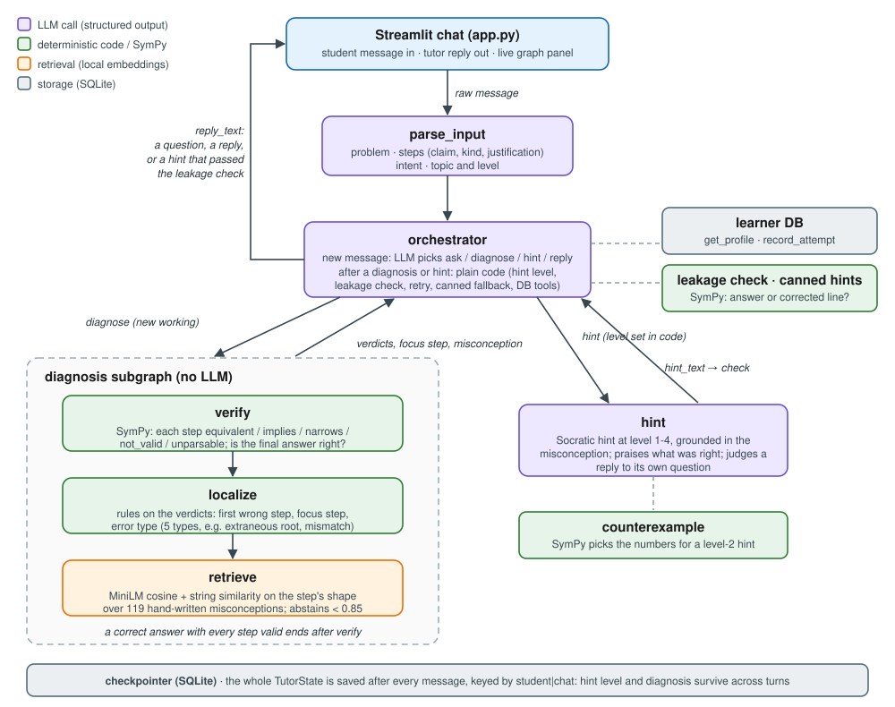
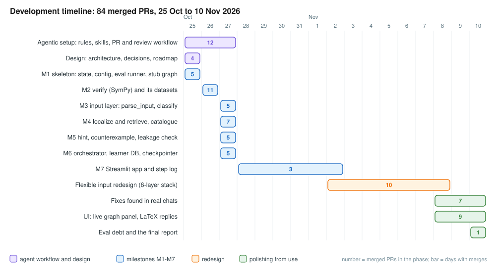

## Summary

<!-- layer 6: the one-paragraph summary, links to the repository, the demo video and the requirement checklist -->

## 1. Business understanding

### The problem

A student solving an algebra problem rarely needs the answer: it is usually at the back of the book. What they need
is to know **where their own working went wrong and why**. A typical case:

$$
3(x + 2) = 15 \;\Rightarrow\; 3x + 2 = 15 \;\Rightarrow\; 3x = 13 \;\Rightarrow\; x = \tfrac{13}{3}
$$

Every line after the first follows correctly from the line before it. The error is in step 1, which multiplies only
the first term in the bracket. A useful tutor points at step 1, recognises the misconception and asks a question that
lets the student find it. It does not write `3x + 6` for them.

### Goal and scope

The system is **not a general math assistant and not a solver**. Its single job is this: take a problem and the
student's own step-by-step attempt, and help the student **repair** it. Concretely, it:

1. checks every step symbolically and finds the first step that does not follow (or the type of error when no single
   step is wrong, such as an extraneous root that was never rejected);
2. names the most likely misconception behind that step;
3. gives graded Socratic hints (level 1 is a question, level 4 is the most direct) that **never reveal the answer or
   the corrected line**;
4. remembers each student's recurring misconceptions across chats.

In scope: school algebra (MATH Prealgebra, Algebra and Intermediate Algebra: linear equations, brackets, quadratics,
factoring, radical and rational equations). Out of scope: calculus, geometry, proofs and other languages. A student
who has a problem but no working gets one guiding question, not a lesson. A student who sends only an answer is asked
for their steps.

### Why a pipeline and not one prompt

A strong chat model with a careful prompt can do much of this in one call, and this project is partly an exercise in
splitting an NLP task into parts that can each be measured. The split still pays for itself, for four reasons:

- **Locating an error is the hard part for LLMs.** Tyen et al. show that models are poor at *finding* reasoning
  mistakes but good at *correcting* them once the location is given [1]. ProcessBench defines exactly this task
  ("identify the earliest erroneous step, or say all steps are correct") and finds it hard for current models [2].
  Daheim et al. find the same for student solutions specifically, and show that verifying first and then generating
  gives better-targeted tutor replies [3]. Here verification is done by a symbolic engine (SymPy), so it is exact for
  the algebra it covers. The LLM never checks algebra.
- **Tutors trade student success against revealing the solution.** MathDial measures this trade-off in human-teacher
  dialogues [4]. A prompt instruction such as "never give the answer" is a soft constraint. Here a deterministic
  leakage check in code rejects any hint that states the answer or the corrected line before the student sees it.
- **Prompt discipline erodes.** Over a long chat a model drifts from a Socratic structure, and a student can simply
  ask for the answer. The hint ladder, its levels and the leakage check live in the graph, so they cannot be talked
  out of.
- **Each stage can be evaluated on its own** (section 5), as the assignment requires.

The retrieval step is not vanilla RAG: it answers "which misconception explains this wrong step?" over a
misconception catalogue, inside a verified diagnosis pipeline. The Eedi "Mining Misconceptions in Mathematics" Kaggle
competition (2024) framed a similar ranking task (match a wrong answer to a misconception, scored with MAP@k) [5].

### Success criteria

- **Diagnosis:** the first wrong step and the error type match the label. The misconception is in the top 5
  retrieved.
- **Hints:** no answer leakage, numbers used only from SymPy, and each hint fits its level.
- **Conversation:** an answer without working is asked for steps, a question escalates the hint level, a correct
  solution is recorded in the student's profile.

## 2. Data understanding and preparation

### What exists, and what was checked

| Source | Checked for | Outcome |
|---|---|---|
| MATH [6], via the `math_splits` files of PRM800K [7] | problems, human-written solutions, subject and level labels | **used** (MIT licence); raw files stay outside the repo, only derived sets are committed |
| PRM800K step ratings [7] | first-error labels | **not used**: solutions are prose plus LaTeX with no converter to plain-text steps, and its `-1` rating means "inaccurate, weird or off-topic", not "algebraically invalid" |
| ProcessBench [2], MathEDU, MR-GSM8K, ErrorRadar, Cognitive Tutor logs | error-step labels and error taxonomies | found in a literature search, not downloaded; as described, none labels our `omission_extraneous_root` or `reasoning_result_mismatch` types, and most are word problems or competition math |
| Eedi misconceptions [5] | a misconception catalogue | **could not be downloaded**, so a catalogue was written instead |
| messy student messages with a known parse | input-layer labels | **none found**, so messages are rendered from mined chains with a known parse |

### What each component is evaluated on

Each set has a fixed **dev** split (all iteration) and a **test** split (final numbers only, write-protected for the
coding agent). Origins: *as-is* = labels taken unchanged from MATH; *mined* = lines extracted from MATH solutions;
*generated* = produced by a rule-based script with a seed; *hand-written* = written and labelled by the coding agent,
with a sample for the developer to spot-check.

| Set (component) | Dev | Test | Origin and where the label comes from |
|---|---|---|---|
| `verify_steps` (verify) | 1,621 | 671 | **mined** consecutive line pairs from MATH Algebra levels 1-3, labelled `equivalent` by the MATH author and kept only where SymPy agrees (787 / 331); **generated** single-token corruptions labelled `not_valid`, kept only if an exact witness point proves them wrong (781 / 317); **hand-written** cases for the rare relations `implies`, `narrows`, `unparsable` (53 / 23) |
| `verify_chains` (verify) | 14 | – | **hand-written** whole solutions with definitions and prose lines |
| `classify` (parse_input topic and level) | 420 | 420 | **as-is** MATH subject and level labels, 60 problems per subject |
| `parse_input` | 185 | 159 | **generated** messages (150 / 150): a mined step chain, sometimes with one wrong step, rendered in 4 layouts and 4 notations (plain, LaTeX, unicode, spoken) with chatty frames and typos in words, so the expected parse is known by construction; **hand-written** messages (20 / 9) and hand-written replies to the tutor (15 / –) |
| `localize` | 78 | 77 | **generated** mined chains with one corrupted step (60 / 60); **hand-written** attempts for every error type (18 / 17), split by problem so no problem is in both |
| misconception catalogue (retrieve) | – | – | **hand-written**: 119 school-algebra misconceptions in 13 categories, each with a description, the correct rule and an example |
| `retrieve` | 324 | 300 | **generated** from 99 mechanical wrong rules, each wrong line confirmed wrong by SymPy (204 / 192); the same rules **wrapped** in a larger expression so the shape differs from the catalogue example (100 / 90); **hand-written** queries (20 / 18). Catalogue entries alternate between splits |
| `hint` | 60 | – | **derived** from `retrieve` queries plus a hint level 1-4, with the gold misconception |
| scenarios A and B (end to end) | 2 | – | **hand-written** multi-turn chats; also the demo script |
| routing turns (orchestrator) | 32 drafts | – | **hand-written**, *unlabelled*: labelling is left to the developer, not the agent |

### Preparation decisions and caveats

- **Dev and test are separated by problem**, not by line, so no problem's steps appear in both. One exception is
  known: 12 identical `verify` pairs from different problems ended up in both splits.
- **Generated data is easier than real students.** Corruptions are single-token edits (a sign, a number, a dropped
  term), and about 5 of 6 mined chains are arithmetic or simplification, not equations. Results are therefore always
  reported **per source**, and the hand-written cases are the discriminating ones.
- **Several sets are high by construction.** Mined positives were kept only where SymPy agreed with the human author,
  and generated `localize` chains were selected with `verify`. These sets act as regression suites. The independent
  check is the build report: SymPy agrees with the MATH author on 1,118 of 1,127 parseable pairs (99.2%) and parses
  90.1% of 1,251 mined pairs.
- **The retrieval data is circular.** The same agent wrote the catalogue and the queries, and 89 of 99 plain
  generated queries have the same shape as their catalogue example. The wrapped and hand-written queries are the
  honest numbers.
- **No dataset example is used in a prompt**, a rule in the agent instructions.
- **Plain-text math is the internal format.** Every claim is stored as plain text that SymPy parses (`x^2`,
  `sqrt(...)`, `(a)/(b)`). `parse_input` converts LaTeX, unicode and spoken math into it. The full data card, with
  field definitions and limits, is in `evals/datasets/README.md`.

## 3. System architecture

The system is a **LangGraph** state machine with a deterministic diagnosis core, wrapped in a small agentic layer.
The agent decides *when* and *whether* to do something; the pipeline decides *how* a diagnosis is done. All nodes read
and write one typed state (`TutorState`, pydantic models in `src/tutor/state.py`). Each node is a pure function that
returns only the fields it changed, and all I/O goes through `src/tutor/tools/`.

### Components

| Component | Kind | Purpose | Input | Output |
|---|---|---|---|---|
| `parse_input` | **LLM**, structured `ParsedInput` | turn a messy message (plain, LaTeX, unicode, spoken math, chatty text) into structure | the student's message, the tutor's last message, the stored problem | `problem`; `student_steps` (claim, kind, justification); `intent` (`check_work`, `stuck`, `answer`, `explain`, `new_problem`, `other`); `topic`, `level` |
| `orchestrator` | **LLM**, structured `Decision`, on a new message; **plain code** otherwise | route the conversation; set or escalate the hint level; run the leakage check; call the learner DB | messages, the parse, the stage, the stored diagnosis | `next_action`; `hint_level`; `error_context`; `reply_text`; profile updates |
| `verify` | **SymPy** | judge every step against the previous line (`equivalent`, `implies`, `narrows`, `not_valid`, `unparsable`) and check the final answer | `problem`, `student_steps` | `step_verdicts`, `is_correct` |
| `localize` | **rules** | first wrong step, the step to talk about, and the error type (`algebraic_transformation`, `omission_extraneous_root`, `reasoning_result_mismatch`, `incomplete`, `other`) | the verdicts and steps | `first_error_step`, `focus_step`, `error_type` |
| `retrieve` | **retrieval** (local MiniLM embeddings + string similarity) | find the misconception behind the wrong step; abstain below a score of 0.85 | the line before the focus step and the line written there | top-5 `misconception_candidates`, `misconception` |
| `hint` | **LLM**, structured `HintText` | write a Socratic hint at the given level, grounded in the misconception; for a reply to its own question, judge whether it moves forward | `error_context`, misconception, level, SymPy counterexample, recent chat | `hint_text`, `reply_moves_forward` |

**Model calls** (the three LLM nodes) go to an OpenRouter free model through `langchain-openai`, always with
structured output (a pydantic model, one retry). The evals used `nvidia/nemotron-3.5-super-vl:free`. A typical
message costs 2-3 calls: `parse_input`, `orchestrator` (skipped when code can route a reply), and `hint` (one more if
the first hint leaks). Prompts live in `src/tutor/prompts/*.md` and are never inline in Python.

**Tool calls** (no model): SymPy parsing and solution sets (`tools/algebra.py`), the counterexample generator that
picks the numbers for a level-2 hint, the leakage check, canned hints for each level, the embedding search over the
119-entry catalogue, the learner DB (`get_profile`, `record_attempt`) and the SQLite checkpointer.

**One hard rule:** the LLM never does arithmetic or checks algebra. A hint may use only numbers that SymPy produced or
that are already in the chat. The one exception: `hint` judges a student's reply to its own question. Every
*submitted step* still goes through SymPy.

### One input, through the whole system

Scenario B is the system's acceptance test and the demo script. The problem is $\sqrt{x+7} = x - 5$, whose only
solution is $x = 9$. The replay test (`tests/test_scenarios.py`) scripts the LLM calls and `retrieve`; where its
outcome differs from a live run, both are stated below.

**Turn 1.** The student writes:
`sqrt(x + 7) = x - 5. x + 7 = x^2 - 25; x^2 - x - 32 = 0; x = (1 +- sqrt(129))/2`

1. `parse_input` (LLM) splits it into the problem and three steps, and tags the message as a request to check work.
2. `orchestrator` (LLM) sees a problem with working and chooses `diagnose`.
3. `verify` (SymPy) squares the original, compares solution sets and finds that step 1 is `not_valid`:
   $(x-5)^2 \ne x^2 - 25$. The later steps follow from step 1, and the final answer is wrong.
4. `localize` (rules) sets the first wrong step to 1, the focus to step 1 and the type to `algebraic_transformation`.
5. `retrieve` reduces the rewrite from the line before step 1 (here the problem itself) to step 1 to its *shape*,
   with variables replaced by `v` and numbers by `n`: `sqrt(v + n) = v - n -> v + n = v^n - n`. It compares this
   shape with the catalogue and returns **M063** "squares both sides of an equation with a radical by squaring each
   term on the right separately" (score 1.0). The replay test scripts `retrieve` to return M038 ("believes that
   $(a - b)^2$ equals $a^2 - b^2$") instead.
6. Back in `orchestrator` (code): this is a new misconception, so the hint level is 1. The step is copied into
   `error_context`.
7. `hint` (LLM) writes a level-1 question that points at how $x - 5$ was squared, after a word on what was right.
8. `orchestrator` (code) runs the leakage check. It blocks the answer $x = 9$ and the expanded, factored or
   simplified form of a side of the problem or of the line before the wrong step, compared with SymPy, not only as
   strings. Its limit: it does not catch every correct next step, so the corrected line $x^2 - 10x + 25$ is not
   blocked by it; only the hint prompt keeps it out. The hint passes, so it is shown and saved.

**Turn 2.** "isn't (x - 5)^2 just x^2 - 25?" The message has no new steps, so `orchestrator` sends it to `hint`
without a new diagnosis. In the replay the level rises to 2. At level 2 the counterexample tool picks a small whole
number that is not a solution, here $x = 2$. SymPy evaluates both lines there: the line before step 1 becomes
$3 = -3$ and the student's line becomes $9 = -21$. The two lines are unbalanced by different amounts (6 and 30), so
step 1 cannot follow from the line before it. The LLM only words the hint around these numbers.

**Turn 3.** The student squares correctly but keeps both roots, $x = 9$ or $x = 2$. Every step is valid; step 1 is
`implies`, not `equivalent`, because squaring can add roots. So `localize` reports `omission_extraneous_root`.
Live, `retrieve` again returns M063 (score 0.966, above the 0.85 threshold; M064 "accepts every root found after
squaring without checking it" is third at 0.702). It is the same misconception as before, so `orchestrator` raises
the hint level by one instead of resetting it. The replay test scripts M064 here, so in the replay the
misconception is new and the level resets to 1.

**Turn 4.** The student substitutes both roots and rejects $x = 2$. `verify` accepts the step that drops $x = 2$
as `narrows`, which is valid only because the remaining set equals the original problem's solution set. The answer
is correct, so `orchestrator` calls `record_attempt` with the misconceptions seen on this problem (live: M063 only;
replay: M038 and M064) and replies without a hint.

In the app, the right-hand panel draws this path live: the running node, the path used, and each node's decisions
and timings (section 6).

## 4. Development plan

The project followed a roadmap of seven milestones (`docs/plans/design/2026-10-25-roadmap.md`), built in the order
of dependencies: the deterministic core first, because everything else is measured against it. Every milestone had
an approved plan in `docs/plans/`, its own PRs, and an evaluation entry in the CRISP-DM log.

| Phase | What was built | Why in this order |
|---|---|---|
| Setup and design | agent rules (`CLAUDE.md`), skills, PR template, review workflow; architecture, decisions log, roadmap | the process had to exist before the first line of code (section 7) |
| M1 skeleton | typed state, config, OpenRouter client, shared eval runner, stub nodes and both graphs compiling | every later node plugs into a fixed contract |
| M2 `verify` | SymPy step relations, the `narrows` relation, the mined and generated datasets | no LLM, and every other node trusts its verdicts |
| M3 input | `parse_input` and `classify` with their datasets | the first LLM nodes, behind one structured-call helper |
| M4 `localize`, `retrieve` | rule-based localization; the hand-written catalogue and shape-based retrieval | needs `verify`'s verdicts |
| M5 `hint` | counterexample tool, leakage check, canned hints, the hint node and its eval | needs a localized step and a misconception |
| M6 orchestration | the orchestrator's three modes, learner DB, checkpointer, scenarios A and B | wires everything into a conversation |
| M7 app | Streamlit chat, step log with timings | makes the system usable and demoable |
| Flexible-input redesign | a 6-layer stack: line kinds and intent in `parse_input`; definitions and prose lines in `verify`; `incomplete` solutions; hints that answer replies; `classify` merged into `parse_input` | real chats showed the pipeline was too strict about input (for example, a correct substitution flagged as an error) |
| Polishing from use | stale-diagnosis fix, clarifying questions, calculation replies, quota message; the live graph panel; LaTeX in replies | each fix came from a real chat in the app |

Two choices shaped the plan. First, the pipeline was **kept** when it got hard: collapsing it to three LLM nodes was
considered and rejected, because it would remove what is measurable and enforceable. Second, when model calls became
the bottleneck (free-tier rate limits, HTTP 429), the redesign layers were shipped with their **evaluation recorded as
debt** rather than measured on noisy partial runs. Section 5 shows what that debt is.

## 5. Evaluation

<!-- layer 5: metric choice per component, results on dev and test, charts, why scores are not higher, debt -->

## 6. Deployment and demo

<!-- layer 6: how to run the app, the demo-video outline -->

## 7. Agentic development setup

<!-- layer 6: CLAUDE.md, skills, subagents, hooks and permissions, the review/fix loop, stacked PRs, the
/address-review GitHub workflow, reflection -->

## 8. Limitations and future work

<!-- layer 6 -->

## 9. Requirement checklist

<!-- layer 6: every item of the assignment mapped to a section -->

## References

1. G. Tyen, H. Mansoor, V. Cărbune, P. Chen, T. Mak. *LLMs cannot find reasoning errors, but can correct them given
   the error location.* Findings of ACL 2024. [arXiv:2311.08516](https://arxiv.org/abs/2311.08516)
2. C. Zheng et al. *ProcessBench: Identifying Process Errors in Mathematical Reasoning.* 2024.
   [arXiv:2412.06559](https://arxiv.org/abs/2412.06559)
3. N. Daheim, J. Macina, M. Kapur, I. Gurevych, M. Sachan. *Stepwise Verification and Remediation of Student
   Reasoning Errors with Large Language Model Tutors.* EMNLP 2024. [arXiv:2407.09136](https://arxiv.org/abs/2407.09136)
4. J. Macina et al. *MathDial: A Dialogue Tutoring Dataset with Rich Pedagogical Properties Grounded in Math Reasoning
   Problems.* Findings of EMNLP 2023. [arXiv:2305.14536](https://arxiv.org/abs/2305.14536)
5. Eedi, Vanderbilt University, The Learning Agency Lab. *Eedi – Mining Misconceptions in Mathematics.* Kaggle
   competition, 2024. Organiser's write-up:
   [eedi.com/blog](https://eedi.com/blog/from-wrong-answers-to-real-insights-how-we-used-a-kaggle-challenge-to-map-student-misconceptions)
6. D. Hendrycks et al. *Measuring Mathematical Problem Solving With the MATH Dataset.* NeurIPS 2021 Datasets and
   Benchmarks. [arXiv:2103.03874](https://arxiv.org/abs/2103.03874)
7. H. Lightman et al. *Let's Verify Step by Step.* 2023 (PRM800K).
   [arXiv:2305.20050](https://arxiv.org/abs/2305.20050)
